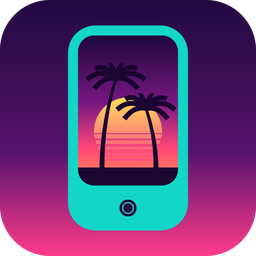

  

<h1 align="center">ViceNano</h1>

  <b>Grand Theft Auto: Vice City running on an iPod nano 7G (2012)</b> 
  Built on <a href="https://github.com/tenspav/NanoEmu">NanoEmu</a> + the reversed <a href="https://github.com/mrxenginner/reVC">reVC</a> engine

  
  
  

---

## Why it can work

| Requirement | PS2 (2002) | nano 7G (unlocked) |
|---|---|---|
| 🧠 CPU | 300 MHz | **684 MHz** (proven unlockable from 342) |
| 💾 RAM | 32 MB | **64 MB** |
| 🎮 GPU | GS ~147 MHz | PowerVR MBX Lite, 133 MHz stock → **171-266 MHz** unlockable |
| 💿 Streaming | DVD drive | NAND flash, **~25-35 MB/s** measured |

> **Performance estimate is in:** ~16 FPS at stock clocks (marginal), **24-30 FPS fully playable with the unlocked 684 MHz CPU + NEON skinning + batching**. Streaming worst case (Downtown, 15.9 MB) fits the 18 MB pool. Details: [`docs/vcfps.md`](docs/vcfps.md), [`docs/vcstream.md`](docs/vcstream.md).

## Development progress

> **Renderer progress:** [M1b](m1b/REPORT.md) verifies native indexed draws; [M2](m2/REPORT.md) renders through librw GLES1; [M3](m3/REPORT.md) renders a VC cone; [M4](m4/REPORT.md) renders a building through reduced reVC. [M5](m5/REPORT.md) streams three real IPL/IDE building cells with a two-block LRU: 66 loads, 64 evictions, 120-byte unloaded-heap variation, and distinct QMP views in NanoEmu, below the 18 MiB budget. [M6](m6/REPORT.md) adds DMA audio: six concurrent SFX voices observed, a complete 60-second radio stream verified in capture, and 28 stop/reinitialise cycles with 100-byte heap variation. [M7](m7/REPORT.md) integrates player input: on-screen touch controls (virtual stick, camera swipe, 10 buttons) and encrypted Bluetooth HID gamepad drive player marker movement and camera orbit in the streamed world; 542 touch events verified with 0-byte heap growth, 7 secure HID reports and full-screen overlay suppression verified in NanoEmu. Packs and compressed radio backing are embedded; NAND streaming, device and full-game gates remain open.

| Stage | Progress | Status |
|---|---|---|
| 🔬 Research |  | every chip documented |
| 🖥️ Emulator |  | boots real OS, window, audio, 3D games, save states, HUD, clock profiles |
| 🔀 Dualboot |  | chainloader round trip works in NanoEmu (OS -> bare metal -> OS) |
| 🎮 GPU access |  | full NanoGL renderer with VGP interpreter; PVRTC pending |
| 🏝️ Engine port |  | reVC → GLES1; [execution plan M0-M9](docs/exec-plan.md) done; [nano7-untethered](https://github.com/olievans123/nano7-untethered) proves 30 fps 3D on this device |
| 🕹️ Controls |  | touch + BT classic HID host verified |

### Engine port milestones (M0-M9)

| Milestone | Progress | What it proves |
|---|---|---|
| M0 triangle |  | first pixel through NanoGL |
| M1 cube |  | textured 3D, native indexed draws |
| M2 librw |  | reVC's graphics library runs on NanoEmu |
| M3 VC model |  | real Vice City asset renders ([cone](m3/REPORT.md)) |
| M4 reVC core |  | reduced reVC viewer renders a VC building ([m4](m4/REPORT.md)) |
|  M5 world stream|  | three building cells stream below 18 MiB; LRU and 64 evictions verified ([m5](m5/REPORT.md)) |
| M6 audio |  | SFX + 60-second radio through DMA/I2S; capture, timing and 28 cycles verified ([m6](m6/REPORT.md)) |
| M7 controls |  | touch + BT gamepad drive the game ([m7](m7/REPORT.md)) |
| M8 performance |  | 24+ fps sustained with unlocked clocks |
| M9 device |  | runs on the real iPod via dualboot |

**Overall: research 100% + emulator 98% + engine 80% = only performance tuning and the device jump remain.**

## The stages

0. ✅ **3D on real hardware is proven** — [nano7-untethered](https://github.com/olievans123/nano7-untethered) ships native Mario Kart 64 (30 fps) and Super Mario 64 ports with an OpenGL ES renderer + tilt steering on this exact device
1. ✅ **Map the hardware** — done in NanoEmu, every chip documented
2. ✅ **Emulator as testbed** — NanoEmu boots the real RetailOS with a live window
3. ✅ **Emulated GPU renders real 3D** — full NanoGL renderer with VGP interpreter
4. ✅ **reVC builds for ARM** — reduced reVC viewer runs in NanoEmu (M4)
5. ✅ **GLES1 backend for librw** — verified through M2-M5
6. 🔜 **Chainloader** — plan validated, payload + hardware shutdown pieces built
7. ⬜ **ViceNano boots in the emulator** — full RAM, unlocked clocks, world streams from NAND
8. ⬜ **ViceNano on real hardware** — dualboot: hold buttons at boot, original OS untouched
9. ⬜ **Mini handheld** — 3D-printed cradle + 8BitDo Lite 2 gamepad (BT HID pairing already works in NanoEmu) + battery

Asset math is closed: the whole game fits via PVRTC 4bpp textures (39 MB) or 8bpp palettes (147 MB), with 1,000-3,000 concurrent textures in the streaming window ([`docs/texture-budget.md`](docs/texture-budget.md)).

## Research feeding this project

All hardware documentation lives in [NanoEmu/docs/research](https://github.com/tenspav/NanoEmu/tree/main/docs/research): GPU/CPU clock unlocks, NAND streaming measurements, the Bluetooth classic stack, the 40 MB shared heap finding, and the dualboot analysis.

## Legal

reVC is a reverse-engineered clean-room reimplementation; game assets are never distributed. You need your own copy of GTA Vice City (PC 1.0). Not affiliated with Rockstar Games, Take-Two, or Apple.
